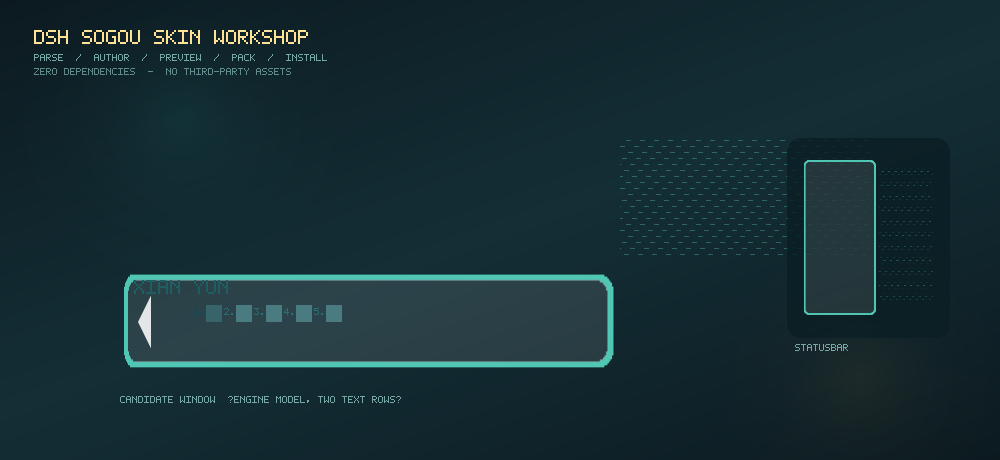
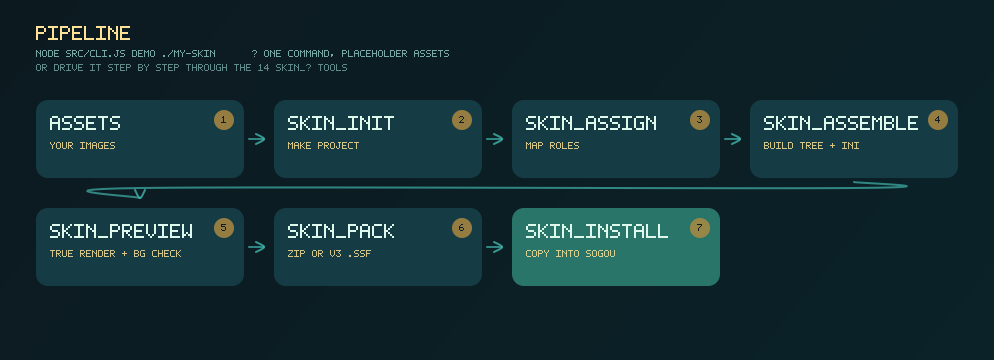
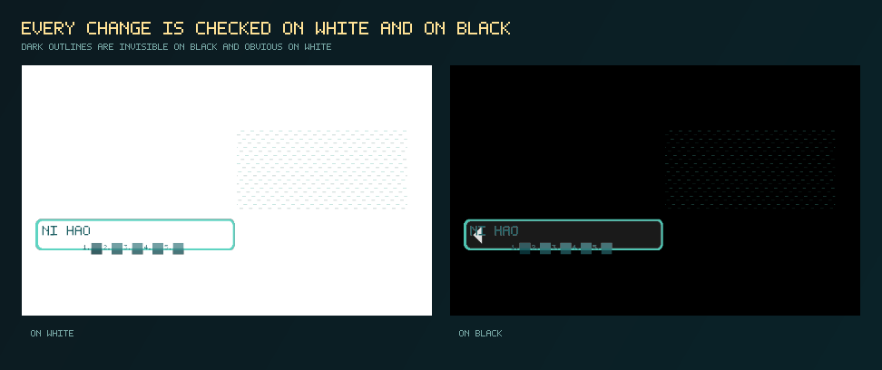
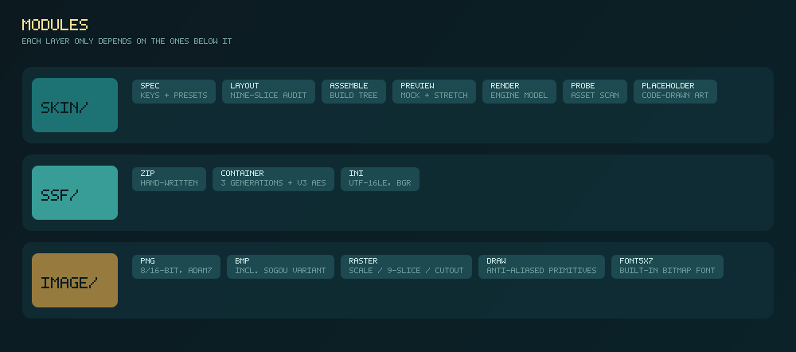

# dsh-sogou-skin

**搜狗输入法皮肤工坊** —— 一个能**解析、制作、预览、打包、安装** `.ssf` 皮肤的工具箱。

既是 [DeepSeek Harness](https://github.com/deepseek-ai) 插件（14 个工具 + 1 个技能），
也是一个**独立命令行程序**。**零第三方依赖** —— PNG / BMP 编解码、ZIP 读写、
v3 加密容器、九宫格拉伸、位图字体、抗锯齿绘图原语，全部是自己写的纯 JavaScript。



> **本仓库不含任何皮肤素材。** 上面这些效果图也全部由代码画出来，见
> [`docs/make-images.mjs`](docs/make-images.mjs)。详见 [ASSET_NOTICE.md](ASSET_NOTICE.md)。

---

## 为什么需要它

做一个搜狗皮肤本来是这样一件事：凑齐几十张图片 → 搞懂 `Skin.ini` 里一百多个键 →
打包 → 装上 → 重启输入法 → 看效果 → 不对 → 改 → 再来一遍。
最麻烦的是**中间那步完全靠猜**：底图该切几宫格？文字该放在哪一行？
为什么立绘被拉扁了？

这个项目把"猜"变成了"算"：**引擎的行为是从真实皮肤与真机截图里标定出来的**，
不是推测。工具会在你打包之前就告诉你哪里会出问题。

---

## 效果图

### 一条流水线



### 每一步都在白底和黑底各看一次



勾边色如果用了近黑，**在黑底上完全隐形、在白底上就是一道黑边**。
这个项目吃过这个亏（见 [LESSONS.md 第 12 条](docs/LESSONS.md)），
所以预览器**每次自动产出白底/黑底对照**，不靠人记得。

---

## 功能

### 14 个工具

| 工具 | 作用 |
|---|---|
| `skin_requirements` | 告诉你一套皮肤最少需要哪些素材 |
| `skin_init` | 建工程（生成 `skin.project.json` + 程序化占位素材）|
| `skin_scan_assets` | 扫描你的图片目录，报告尺寸、透明度、主色 |
| `skin_assign` | 把素材分配到各个角色 |
| `skin_assemble` | 装配成皮肤文件树 + `Skin.ini` |
| `skin_preview` | **按引擎模型真渲染**：拟真图 + 拉伸体检 + 白底对照 |
| `skin_repair` | 细节修复（抠图、去边、补角）|
| `skin_pack` | 打包成 `.ssf`（ZIP 代际 / v3 加密代际）|
| `skin_inspect` | 查看一个 `.ssf` 的完整结构 |
| `skin_unpack` | 解开 `.ssf` |
| `skin_validate` | 校验，含**九宫格退化探测** |
| `skin_overlay_presets` | 浮层按钮的 15 组官方对齐预设 |
| `skin_install` | 装到本机搜狗 |
| `skin_list_installed` | 列出本机已装皮肤 |

外加技能 **`sogou-skin-authoring`**：把"像设计师一样做皮肤"的完整流程
（先定配色 → 逐图层 → 每步识图 → 不满意就返工）写成可复用步骤。

### 能力清单

- **三代 .ssf 容器**全部可读写：明文 ZIP / `"Skin"+v3` AES-256 + zlib / `"Skin"+v1` 明文表
- **PNG**：8/16 位，灰度 / 调色板 / RGB / RGBA，Adam7 隔行
- **BMP**：含搜狗特有的 20×20 按钮变体（1254 与 1256 字节两种尾部）
- **绘图原语**：多段线性渐变、径向渐变、抗锯齿曲线、外/内发光、高斯模糊、颗粒、**沿轮廓勾边**
- **位图基元**：缩放、九宫格、抠图、调色、主色提取、内容裁剪
- **程序化占位素材**：不需要任何素材就能产出一套**可安装**的皮肤
- **跨版本安装探测**：标准版 / 医生版 / 各安装路径

---

## 模块



分三层，**上层只依赖下层**：

```
skin/     业务层 —— 键词表、九宫格体检、装配器、引擎模型渲染器
ssf/      容器层 —— 手写 ZIP、三代容器识别与解密、Skin.ini 解析
image/    图像层 —— PNG/BMP 编解码、位图基元、绘图原语、点阵字体
```

| 文件 | 说明 |
|---|---|
| `src/skin/spec.js` | 304 个已知键、7 个段落、13 个按钮槽位、15 组官方浮层预设 |
| `src/skin/layout.js` | 九宫格探测与**退化体检** |
| `src/skin/assemble.js` | 从工程配置装配出完整皮肤 |
| `src/skin/render.js` | **引擎模型渲染器**（真渲染 + 白底对照）|
| `src/skin/preview.js` | 设计示意图 + 拉伸体检 |
| `src/skin/placeholder.js` | 程序化占位素材（纯代码画的几何图形）|
| `src/ssf/container.js` | 三代容器识别 + v3 AES-256-CBC 解密 |
| `src/ssf/zip.js` | 手写 ZIP，含搜狗私有 `SD` 扩展字段 |
| `src/ssf/ini.js` | UTF-16LE + BOM 解析，**颜色是 `0xBBGGRR` 不是 RGB** |
| `src/image/draw.js` | 15 个抗锯齿绘图原语 |
| `src/image/raster.js` | 22 个位图操作 |

---

## 它是怎么工作的

### 引擎模型

这几条结论**全部来自真实皮肤与真机截图**，不是推测：

**① 窗口尺寸 —— 纵向永不缩放**

真机实测（DPI 168，缩放 1.75×）：底图 650×258 → 候选窗 460×259 逻辑像素。
**宽度按内容算，高度 = 底图原始高度。**

**② 九宫格退化 —— "整张图被压扁"的唯一根因**

引擎要把底图按九宫格铺进 W×H 的窗口。只要：

```
left + right > W      或      top + bottom > H
```

九宫格就不成立，引擎**只能把整张底图硬缩放到 W×H** ——
立绘被压扁、文字跑位、上下两排错乱，全是这一个原因。

关键推论：**只在真正会变化的那根轴上设内缩**。

| 段落 | 怎么变 | 该设防的轴 | 另一轴 |
|---|---|---|---|
| 横排候选窗 | 打字变长 → 只变宽 | `layout_horizontal` | `layout_vertical = 0,0,1` |
| 竖排候选窗 | 候选变多 → 只变高 | `layout_vertical` | `layout_horizontal = 0,0,1` |

**③ 候选窗里是上下两排文字**

```
  ┌──────────────────────────────────────┬──────────┐
  │ 搜狗PINYIN            ← 拼音行        │          │
  │ 1.拼音 2.品 3.频 4.拼 5.贫 ◀ ▶  ← 候选行│  立绘    │
  └──────────────────────────────────────┴──────────┘
```

```
拼音行 y = pinyin_marge[0]                                  ← 【绝对 y】
候选行 y = pinyin_marge[0] + font_size + zhongwen_marge[0]  ← 后者是【间距】
```

> 这两个字段的语义**不一样**，混起来会让候选行偏出一百多像素。
> 这个 bug 在本项目里真实存在过，见 [LESSONS.md](docs/LESSONS.md)。

**④ 候选条必须贴到图片底边**

候选词会依次往下排。如果底图里条子下方是透明的，第二行以后的候选就没有背景。
修法：条子下沿做到图片底边，并把 `layout_vertical` 改成 `<条子上沿 y>,0`。

### 一条命令的流程

```
  你的图片  →  skin_init  →  skin_assign  →  skin_assemble
                                              ↓
                            skin_install  ←  skin_pack  ←  skin_preview
```

---

## 用法

### 最快：不需要任何素材

```
node src/cli.js demo ./my-skin
```

一条命令建工程 → 生成占位素材 → 装配 → 预览 → 打包，得到一个**能装的 `.ssf`**。

### 用自己的素材

```
node src/cli.js requirements              # 先看需要哪些素材
node src/cli.js init     ./my-skin        # 建工程
#   把图片放进 my-skin/assets/，再编辑 skin.project.json 分配角色
node src/cli.js scan     ./my-skin        # 扫描素材，报告客观特征
node src/cli.js assemble ./my-skin        # 装配
node src/cli.js validate ./my-skin        # 校验（出错返回非零退出码）
node src/cli.js preview  ./my-skin        # 出预览图，先看 bgcheck.png
node src/cli.js pack     ./my-skin -o my-skin.ssf
node src/cli.js install  my-skin.ssf      # 装到本机搜狗
```

全部命令：

```
node src/cli.js requirements            列出做皮肤需要哪些素材
node src/cli.js init <dir> [--name X]   新建皮肤工程
node src/cli.js scan <dir>              扫描素材目录
node src/cli.js assemble <projectDir>   装配出皮肤目录
node src/cli.js validate <projectDir>   校验（错误返回非零退出码）
node src/cli.js preview <projectDir>    生成预览图
node src/cli.js pack <dir> [--format zip|v3] [--out x.ssf]
node src/cli.js inspect <file.ssf>      解析皮肤包
node src/cli.js unpack <file.ssf> [dir] 解包皮肤
node src/cli.js demo <dir>              一条龙演示
```

### 作为 DSH 插件

```
dsh plugin add <本仓库路径>
```

装好后可以直接用自然语言驱动 14 个工具，技能 `sogou-skin-authoring` 会引导整个创作流程。

### 支持哪些搜狗版本

安装路径探测覆盖：

| 版本 | 用户皮肤目录 |
|---|---|
| 标准版搜狗 | `%APPDATA%\SogouInput\AllSkin`、`%LOCALAPPDATA%\SogouInput\AllSkin` |
| **搜狗医生版** | **`%USERPROFILE%\AppData\LocalLow\SogouYS\AllSkin`** ← 注意是 **LocalLow** |
| 部分版本 | 安装目录下的 `<版本号>\AllSkin`（`Program Files (x86)\SogouYSInput` 等）|

> **LocalLow 是 Local 的兄弟目录，不是子目录。** 这一点卡了很久 ——
> 医生版既不在 `Local` 也不在 `APPDATA`，常规经验完全找不到。
> 找不到时工具会打印各版本的常见位置，以及怎么自行定位。

---

## 测试

全部测试 **不需要任何外部素材**，在干净 checkout 里可直接运行：

```
npm run test:all
```

| 测试 | 守住什么 |
|---|---|
| `image.test.mjs` | 图像层（PNG/BMP 往返、缩放、九宫格、抠图）|
| `container.test.mjs` | 两代容器往返 + v3 内层重建逐字节一致 |
| `zipdiff.mjs` | ZIP 结构不变量（顺序 / 方法 / version / SD 扩展字段）|
| `clone.test.mjs` | 克隆保真（配置零差异 + 50 万像素逐像素一致）|
| `rowmodel.mjs` | 两排文字的位置公式 |
| `stretch.mjs` | 九宫格在真机实测窗口尺寸下不退化 |
| `validate_check.mjs` | 校验器（正常工程零错误 + 负例会报错）|
| `bgcheck_test.mjs` | 白底/黑底对照确实产出 |
| `keys.test.mjs` `vocab.test.mjs` | 键词表与覆盖率 |
| `overlay.mjs` | 浮层预设 + 修图 |
| `install.test.mjs` | 安装路径探测 |
| `plugin.smoke.mjs` | 插件加载冒烟 |
| `compare_sogou.mjs` | 与官方渲染对拍（需 `SOGOU_SKIN_REFSKINS`）|

其中 13 个**自己造数据**（用程序化占位素材生成皮肤再对自己的产物做断言），
只有 `compare_sogou` 需要外部基准。
**样本缺失时会跳过并说明原因，不会静默通过。**

---

## 文档

| 文档 | 内容 |
|---|---|
| **[docs/LESSONS.md](docs/LESSONS.md)** | **推荐先读。** 20 条真实踩过的坑，按"早知道能省多少事"排序 |
| [docs/SSF-FORMAT.md](docs/SSF-FORMAT.md) | `.ssf` 容器格式与 `Skin.ini` 结构解析 |
| [CHANGELOG.md](CHANGELOG.md) | 版本能力清单 |
| [ASSET_NOTICE.md](ASSET_NOTICE.md) | 素材声明 |
| [test/README.md](test/README.md) | 每个测试测什么、为什么有几个需要外部样本 |
| [examples/README.md](examples/README.md) | 示例说明 |

`docs/LESSONS.md` 里有几条比代码更值钱的东西，比如：

- **「改了文件」≠「引擎用了新文件」** —— 搜狗把皮肤缓存在 `skin_v3.dat`，不删它改什么都没用
- **看图说不清时，去量一个数** —— 我"觉得按钮圆角被切了"，量了 alpha 才发现真正的问题是"上半块全透明"
- **会在合法输入上报错的断言，比没有断言更糟** —— 它会驱使你去改坏本来正确的东西

---

## 目录结构

```
dsh-sogou-skin/
├── src/
│   ├── index.js          插件入口（注册工具与技能）
│   ├── tools.js          14 个 skin_* 工具
│   ├── cli.js            独立命令行（10 条命令）
│   ├── image/            零依赖图像层
│   ├── ssf/              容器格式
│   └── skin/             业务层
├── skills/sogou-skin-authoring/SKILL.md
├── examples/             可移植示例
├── test/                 14 个测试
└── docs/
    ├── LESSONS.md        经验教训
    ├── SSF-FORMAT.md     格式解析
    ├── make-images.mjs   效果图生成脚本
    └── images/           效果图
```

---

## 许可

代码：**MIT**（见 [LICENSE](LICENSE)）。

**素材：本仓库不包含任何素材。** 插件里的"占位素材"都是运行时用代码画出来的几何图形，
效果图也全部由 [`docs/make-images.mjs`](docs/make-images.mjs) 生成。
详见 [ASSET_NOTICE.md](ASSET_NOTICE.md)。
